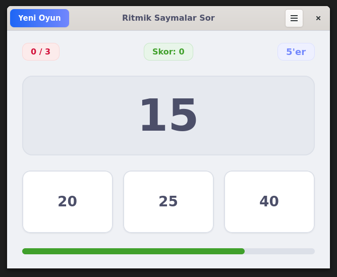
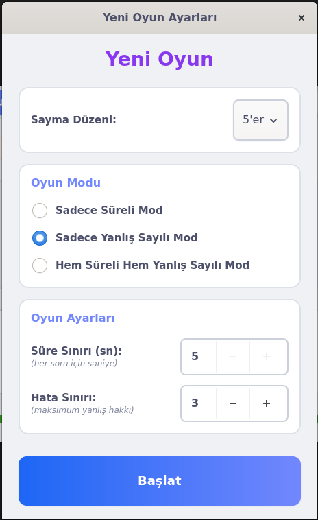

<div align="center">


# Ritmik Saymalar Sor

**Pardus ETAP (Etkileşimli Tahta) ve Linux Masaüstü Sistemler İçin PyGTK4 Tabanlı Ritmik Sayma Eğitim Oyunu**

[](#)
[-4a86cf?style=flat-square)](#)
[](#)
[](#)
[](#lisans)

</div>

---

## 🎯 Proje Hakkında

**Ritmik Saymalar Sor**, ilkokul ve ortaokul seviyesindeki öğrencilerin ritmik sayma becerilerini eğlenceli ve etkileşimli bir şekilde geliştirmek amacıyla tasarlanmıştır. **Pardus ETAP** etkileşimli tahtalarda dokunmatik kullanıma uygun büyük butonları, renkli geri bildirimleri ve ses efektleri ile sınıf içi etkinlikler ve bireysel pratik için idealdir.

---

## 📸 Ekran Görüntüleri

<div align="center">
<table>
  <tr>
    <td align="center"><b>Oyun Ekranı</b></td>
    <td align="center"><b>Yeni Oyun ve Mod Ayarları</b></td>
  </tr>
  <tr>
    <td align="center">
      
    </td>
    <td align="center">
      
    </td>
  </tr>
</table>
</div>

---

## ✨ Özellikler

- **Pardus ETAP & Dokunmatik Uyumlu Arayüz:** GTK4 ve özel CSS ile tasarlanmış, akıllı tahtalarda rahatça tıklanabilen geniş seçenek kartları.
- **Esnek Ritmik Sayma Seçenekleri:** `2'şer`, `3'er`, `4'er`, `5'er`, `6'şar`, `7'şer`, `8'er`, `9'ar` ve `10'ar` ritmik sayma düzenleri.
- **3 Farklı Oyun Modu:**
  1. **Sadece Süreli Mod:** Hata sınırı olmaksızın her soru için belirlenen süre içinde doğru cevabı bulma.
  2. **Sadece Yanlış Sayılı Mod:** Süre baskısı olmadan belirlenen maksimum hata hakkı dolana kadar ilerleme.
  3. **Hem Süreli Hem Yanlış Sayılı Mod *(Varsayılan)*:** Hem süre çubuğu hem de hata sınırının aktif olduğu tam yarışma modu.
- **Dinamik Süre Çubuğu ve Sesli Bildirimler:** Kalan süreye göre **Yeşil → Sarı → Kırmızı** renk değiştiren ilerleme çubuğu ve doğru/yanlış cevaplar için ses efektleri.
- **Debian (`.deb`) Paket Desteği:** Sistem uygulama menüsünde **Eğitim (Education)** kategorisi altında otomatik olarak listelenir.

---

## 📦 Kurulum

### Yöntem 1: Hazır `.deb` Paketi ile Kurulum (Önerilen)

Proje kök dizininde yer alan `ritmik-saymalar-sor_1.0.0_all.deb` paketini doğrudan Pardus veya Debian tabanlı sisteminize kurabilirsiniz:

```bash
sudo apt install ./ritmik-saymalar-sor_1.0.0_all.deb
```

Kurulum tamamlandıktan sonra uygulama **Eğitim (Education)** menüsünde **Ritmik Saymalar Sor** olarak yerini alır veya terminalden aşağıdaki komutla başlatılabilir:

```bash
ritmik-saymalar-sor
```

---

### Yöntem 2: Kaynak Koddan ve `.venv` Sanal Ortamı ile Çalıştırma

1. **Sistem Bağımlılıklarını Yükleyin:**
   ```bash
   sudo apt update
   sudo apt install -y python3-venv python3-gi python3-gi-cairo gir1.2-gtk-4.0 \
                       gir1.2-gst-plugins-base-1.0 gstreamer1.0-plugins-base \
                       gstreamer1.0-plugins-good
   ```

2. **`.venv` Sanal Ortamını Oluşturun ve Etkinleştirin:**
   ```bash
   python3 -m venv --system-site-packages .venv
   source .venv/bin/activate
   ```

3. **Uygulamayı Başlatın:**
   ```bash
   python3 main.py
   ```

> 💡 **Windows 11 (WSL2 / WSLg)** üzerinde çalıştırma komutları için [`run_app.md`](run_app.md) dosyasına göz atabilirsiniz.

---

## 🛠️ `.deb` Paketini Yeniden Oluşturma

Kaynak kodda değişiklik yaptıktan sonra yeni bir `.deb` paketi üretmek için:

```bash
sudo apt install -y debhelper dh-python build-essential
dpkg-buildpackage -us -uc -b
```

---

## 📁 Proje Yapısı

```text
ritmik-saymalar-sor/
├── main.py                              # GTK4 Gtk.Application giriş noktası
├── ritmik-saymalar-sor_1.0.0_all.deb    # Kuruluma hazır Debian paketi (v1.0.0)
├── ritmik-saymalar.desktop              # Masaüstü menü kısayolu (Education;Math;)
├── run_app.md                           # Linux ve Win11 WSL çalıştırma kılavuzu
├── debian/                              # Debian paket yapılandırma dosyaları
├── screenshots/                         # Uygulama ekran görüntüleri
│   ├── oyun_ekrani.png
│   └── yeni_oyun_ekrani.png
├── resources/
│   ├── icons/                           # Uygulama ikonu ve vektörel görseller
│   ├── sound/                           # Doğru ve yanlış cevap ses efektleri
│   └── styles/style.css                 # GTK4 CSS tema dosyası
└── src/
    ├── game_engine.py                   # Ritmik sayma soru ve skor motoru
    ├── mainwindow.py                    # Ana oyun penceresi (Gtk.ApplicationWindow)
    ├── new_game_window.py               # Yeni oyun ve mod seçim penceresi
    └── game_over_dialog.py              # Oyun sonu skor penceresi
```

---

## 👤 Geliştirici & Paket Bakımı

- **Maintainer:** halilsaygin / hllsygn

## 📄 Lisans

Bu proje **MIT Lisansı** altında lisanslanmıştır.
